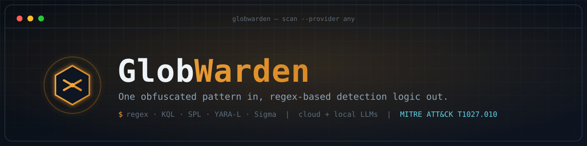

<div align="center">



**One obfuscated pattern in, regex-based detection logic out — in five query languages.**

[](LICENSE)
[](pyproject.toml)
[](https://github.com/bobby-tablez/GlobWarden/actions/workflows/ci.yml)
[](https://github.com/astral-sh/ruff)
[](https://attack.mitre.org/techniques/T1027/010/)

</div>

## What is this

GlobWarden reads a threat-intel report — a URL, a local PDF, raw text, a code/script
file, or a screenshot — and uses an LLM (cloud or fully local) to identify **command
obfuscation techniques** described or shown in it: the T1027.010 family of tricks
(character masking, wildcard/glob-based alias resolution, string concatenation,
environment-variable indirection, encoded download cradles, and similar
pattern-matching-evasion techniques). For each technique it finds, it generates the
matching regex — formatted for up to five query languages at once — **regex, KQL,
SPL, YARA-L, and Sigma** — in one pass, rendered in a colorized terminal UI. Output
is the matching expression itself (a bare regex line for KQL/SPL/YARA-L, just the
`detection:` block for Sigma), not a complete standalone rule — GlobWarden expects
you to drop it into your own rule structure, not ship it as one.

It exists because of a gap. Wildcard-based `Get-Alias`/`Get-Command` →
`Invoke-Expression` resolution used to invoke a cmdlet indirectly is exactly the
kind of pattern that had no name in MITRE ATT&CK until T1027.010 was written — and
that gap only closes when someone sits down, reads a report by hand, and translates
"here's the pattern" into "here's how you'd actually detect it." GlobWarden
automates that translation as a *starting point*. It's a detection-engineering
assistant that requires analyst review, not a certified translation engine that
replaces one — say that plainly, because it's true and because overselling
accuracy on a security tool is how trust gets burned.

## See it run

```text
$ globwarden scan demo --provider fake --rules regex,sigma,kql

┏━ GlobWarden ━━━━━━━━━━━━━━━━━━━━━━━━━━━━━━━━━━━━━━━━━━━━━━━━━━━━━━━━━━━━━━━━━━━━━━━━━━━━━━━━━┓
┃                                                                                              ┃
┃    ◈  G L O B W A R D E N                                                                    ┃
┃                                                                                              ┃
┃    one obfuscated pattern in — regex-based detection logic out, in five query languages      ┃
┃                                                                                              ┃
┃    T1027.010 command obfuscation  ·  v0.3.0                                                  ┃
┃                                                                                              ┃
┗━━━━━━━━━━━━━━━━━━━━━━━━━━━━━━━━━━━━━━━━━━━━━━━━━━━━ feed it a report, get detection content ━┛
    target  demo             
  provider  fake (fake-mini) 
rule types  regex, sigma, kql
────────────────────────────────────────────────────────────────────────────────────────────────
⠋ pipeline complete. ━━━━━━━━━━━━━━━━━━━━━━━━ 0:00:00

───────────────────────────────────── detected techniques ──────────────────────────────────────

╭─ [1/4] Wildcard Get-Alias Resolution to Invoke-Expression ───────────────────────────────────╮
│                                                                                              │
│      category Wildcard / Glob Resolution                                                     │
│        att&ck T1027.010 (parent: T1027)                                                      │
│    confidence ▰▰▰▰▰▰▰▰▰▱  91%                                                                │
│                                                                                              │
│               Command-line alias lookups are performed with a truncated wildcard pattern     │
│               (e.g. `Get-Alias i*x`) instead of the literal alias name, resolving to iex at  │
│               runtime and defeating substring-match detections written against the literal   │
│               string.                                                                        │
│                                                                                              │
│       example (Get-Alias i*x)[0].Definition | % { & $_ $cmd }                                │
│                                                                                              │
╰──────────────────────────────────────────────────────────────────────────────────────────────╯

    ┌─ ✓ REGEX ────────────────────────────────────────────────────────────────────────────────┐
    │                                                                                          │
    │  (?i)get-(alias|command)\s+[a-z]{1,3}\*[a-z]{0,4}\b                                      │
    │                                                                                          │
    │  Flags the characteristic tokens of this technique in command-line/script-block          │
    │  telemetry.                                                                              │
    │                                                                                          │
    └──────────────────────────────────────────────────────────────────────────────────────────┘
    ┌─ ✓ SIGMA ────────────────────────────────────────────────────────────────────────────────┐
    │                                                                                          │
    │  selection:                                                                              │
    │    CommandLine|re: (?i)get-(alias|command)\s+[a-z]{1,3}\*[a-z]{0,4}\b                    │
    │  condition: selection                                                                    │
    │                                                                                          │
    │                                                                                          │
    │  Flags the characteristic tokens of this technique in command-line/script-block          │
    │  telemetry.                                                                              │
    │                                                                                          │
    └──────────────────────────────────────────────────────────────────────────────────────────┘
    ┌─ ✓ KQL  (Microsoft Sentinel) ────────────────────────────────────────────────────────────┐
    │                                                                                          │
    │  ProcessCommandLine matches regex @"(?i)get-(alias|command)\s+[a-z]{1,3}\*[a-z]{0,4}\b"  │
    │                                                                                          │
    │  Flags the characteristic tokens of this technique in command-line/script-block          │
    │  telemetry.                                                                              │
    │                                                                                          │
    └──────────────────────────────────────────────────────────────────────────────────────────┘

    … 2 more findings, same layout (backtick-split masking, env-var-assembled cmdlet) …

╭─ [4/4] Base64-Encoded Download Cradle ───────────────────────────────────────────────────────╮
│                                                                                              │
│      category Encoded Download Cradle                                                        │
│        att&ck T1027.010 (parent: T1027), T1140 (Deobfuscate/Decode)                          │
│    confidence ▰▰▰▰▰▰▰▰▰▱  93%                                                                │
│                                                                                              │
│               A -EncodedCommand/-enc invocation carries a base64-encoded UTF-16LE payload    │
│               that downloads and executes a secondary stage, hiding the actual               │
│               download-and-execute logic from plain-text command-line scans.                 │
│                                                                                              │
│       example powershell -nop -w hidden -enc SQBFAFgAIAAoAE4AZQB3...                         │
│                                                                                              │
╰──────────────────────────────────────────────────────────────────────────────────────────────╯

    ┌─ ✗ REGEX ────────────────────────────────────────────────────────────────────────────────┐
    │                                                                                          │
    │  ⚠ VALIDATION FAILED — Pattern did not compile with Python's re module: missing ),       │
    │  unterminated subpattern at position 44 (still invalid after 2 retries)                  │
    │                                                                                          │
    │  (?i)-enc(odedcommand)?\s+[A-Za-z0-9+/=]{20,}(                                           │
    │                                                                                          │
    │  Flags the characteristic tokens of this technique in command-line/script-block          │
    │  telemetry.                                                                              │
    │                                                                                          │
    └──────────────────────────────────────────────────────────────────────────────────────────┘
    ┌─ ✓ SIGMA ────────────────────────────────────────────────────────────────────────────────┐
    │                                                                                          │
    │  selection:                                                                              │
    │    CommandLine|re: (?i)-enc(odedcommand)?\s+[A-Za-z0-9+/=]{20,}(                         │
    │  condition: selection                                                                    │
    │                                                                                          │
    │                                                                                          │
    │  Flags the characteristic tokens of this technique in command-line/script-block          │
    │  telemetry.                                                                              │
    │                                                                                          │
    └──────────────────────────────────────────────────────────────────────────────────────────┘
    ┌─ ✗ KQL  (Microsoft Sentinel) ────────────────────────────────────────────────────────────┐
    │                                                                                          │
    │  ⚠ VALIDATION FAILED — Generated content has unbalanced parentheses/braces/brackets.     │
    │  (still invalid after 2 retries)                                                         │
    │                                                                                          │
    │  ProcessCommandLine matches regex @"(?i)-enc(odedcommand)?\s+[A-Za-z0-9+/=]{20,}("       │
    │                                                                                          │
    │  Flags the characteristic tokens of this technique in command-line/script-block          │
    │  telemetry.                                                                              │
    │                                                                                          │
    └──────────────────────────────────────────────────────────────────────────────────────────┘


                 scan summary                  
╭───────────────────┬─────────────────────────╮
│ metric            │                   value │
├───────────────────┼─────────────────────────┤
│ findings          │                       4 │
│ rules generated   │                      12 │
│ passed validation │                      10 │
│ failed validation │                       2 │
│ by rule type      │ kql:4  regex:4  sigma:4 │
╰───────────────────┴─────────────────────────╯
```

`--provider fake` above is real, not a mockup — it's a network-free built-in stub
(`globwarden scan demo --provider fake`) that reproduces this output byte-for-byte
with zero setup and no API key, right now. Point it at a real provider and a real
report — `globwarden scan ./notes.pdf --provider openai` — and the pipeline,
validation, and rendering are identical; only the findings come from a real model
instead of the demo stub, and generation makes one combined LLM call per finding
(covering every requested format at once) rather than one call per format. And that
`✗ REGEX` / `✗ KQL` pair above isn't a glitch left in by accident — it's the
validation step doing its job: content that fails its syntactic check gets the
failure reason fed back to the model for another attempt (capped at a couple of
retries, so a stubborn format can't run away with your API budget), and if it's
still invalid after that — as it deliberately is here, to show the path — it's shown
anyway, flagged, with the real compiler/parser error and retry count attached.
Nothing gets silently dropped. Notice the REGEX/SIGMA/KQL panels above are just the
matching expression for each language, not a complete standalone rule — no title,
no logsource, no rule `id` — that's deliberate: GlobWarden hands you the detection
logic to drop into your own rule structure, not a finished rule file.

## Quickstart

```bash
pip install globwarden

# or, with PDF/web/image ingestion support included:
pip install "globwarden[all]"
```

Pick any one of the five providers — cloud or fully local:

```bash
# OpenAI
export OPENAI_API_KEY="sk-..."
globwarden scan ./report.pdf --provider openai

# Anthropic
export ANTHROPIC_API_KEY="sk-ant-..."
globwarden scan ./report.pdf --provider anthropic

# Google Gemini
export GOOGLE_API_KEY="..."
globwarden scan "https://example.com/blog/campaign-writeup" --provider gemini

# Ollama — local, fully offline
ollama pull llama3.2
globwarden scan ./sample.ps1 --provider ollama

# LM Studio — local, fully offline
# (start the local server from the LM Studio app's Developer tab first)
globwarden scan ./screenshot.png --provider lmstudio
```

Full per-provider setup (API key details, local server install commands) lives in
[`docs/providers.md`](docs/providers.md).

## Features

- **Five input types** — URL, local PDF, raw text, a code/script file, or an image,
  auto-detected from what you point it at.
- **One combined call, five outputs** — regex, KQL, SPL, YARA-L, and Sigma matching
  logic generated together per finding, cross-referenced back to the technique that
  produced them. Output is the matching expression itself (a bare regex line, or
  just Sigma's `detection:` block), not a complete standalone rule.
- **Cloud or fully offline** — OpenAI, Anthropic, and Gemini for cloud use; Ollama
  and LM Studio for orgs that can't send threat intel to a third-party API.
- **Vision-aware** — a screenshot of a report, tweet, or slide works as a source on
  providers/models that support vision; embedded screenshots in a fetched web page
  are pulled out and analyzed too.
- **Validated output, retried until it's right, never silently dropped** — every
  generated matching expression is checked for syntactic validity (does it compile
  as regex, parse as YAML, etc.); a format that fails gets the failure reason fed
  back to the model and another attempt, capped at a few retries so a stubborn
  format can't run away with your API budget. Still invalid after that, it's shown
  flagged with a reason — never hidden, never silently wrong.
- **Confidence + ATT&CK mapping on every finding** — so you know what to
  double-check first, not just what the model produced.
- **Terminal output built for demos** — colorized, structured `rich` rendering,
  not a wall of raw JSON — and `--output-file report.txt` saves that exact same
  layout as a clean, portable text file when a scan's too long for scrollback.
  `--output markdown`/`json` work with `--output-file` too.

## How it's different

Narrow input (obfuscation TTPs specifically, not general IOC/TTP extraction), broad
output (five query languages' worth of matching logic in one pass, not one), and
first-class local-LLM support for orgs that can't send threat intel to a cloud API.
That's the real, defensible niche — GlobWarden doesn't replace analyst review or a
certified rule-translation engine, and doesn't claim to.

Worth knowing what else is out there, honestly:

- **[DIANA](https://github.com/dwillowtree/diana)** is the closest analog —
  report/URL/doc text → detection logic via LLM (OpenAI/Anthropic/Groq). GlobWarden
  differs by fanning out to five rule languages in one pass instead of one, staying
  obfuscation-technique-focused rather than doing general IOC/TTP extraction, adding
  first-class local-LLM support, and being PDF/code-file-first rather than
  URL/text-first.
- **[Uncoder AI / Uncoder.io](https://uncoder.io)** (SOC Prime) is the dominant
  *rule translation* tool — Sigma/Roota into 48+ SIEM languages. It translates
  existing, already-written rules. GlobWarden does the step before that: reading a
  report that has no detection logic yet and drafting the matching expression for
  it. Complementary, not competing.
- **LLMCloudHunter and SigmaGen** are academic/research pipelines that proved the
  report-to-Sigma concept works (LLMCloudHunter reports 92% precision), but neither
  is a maintained OSS CLI, and both target a single output format.
- **Revoke-Obfuscation, PSDecode, and CyberChef** solve the other half of the
  problem — deobfuscating or scoring a *sample you already have*, not extracting
  techniques *described in a report* you're reading. Good prior art in the
  obfuscation-detection space generally, just a different input.

## Supported rule languages

| Format | Targets |
|---|---|
| **Regex** | Universal pattern matching — portable into EDR custom detections, log pipeline filters, or anywhere a plain pattern works. |
| **KQL** | Kusto Query Language — Microsoft Sentinel / Defender for Endpoint hunting queries. |
| **SPL** | Search Processing Language — Splunk. |
| **YARA-L** | Google Security Operations (Chronicle) detection rules. |
| **Sigma** | Vendor-neutral detection-as-code — convertible to dozens of SIEMs via `pySigma`/`sigma-cli` or Uncoder.io; the closest thing to a lingua franca here. |

## Supported providers

| Provider | Type | Vision support | Setup |
|---|---|---|---|
| OpenAI | Cloud | Yes (`gpt-4o` family) | `OPENAI_API_KEY` |
| Anthropic | Cloud | Yes (Claude 3+; `claude-opus-5` by default) | `ANTHROPIC_API_KEY` |
| Google Gemini | Cloud | Yes (Gemini 2.0+) | `GOOGLE_API_KEY` (or `GEMINI_API_KEY`) |
| Ollama | Local | Model-dependent (e.g. `llama3.2-vision`) | `ollama serve` |
| LM Studio | Local | Model-dependent | Local server via app's Developer tab |

Full setup instructions (env vars, local install/pull commands) are in
[`docs/providers.md`](docs/providers.md).

## Docs

- [`docs/architecture.md`](docs/architecture.md) — pipeline internals, module map,
  and the design decisions behind them.
- [`docs/providers.md`](docs/providers.md) — detailed setup for all five LLM
  providers, including local server installation.

## Contributing

Contributions are welcome, especially new LLM providers (the OpenAI-compatible base
class makes this close to a five-line change) and new rule languages. See
[`CONTRIBUTING.md`](CONTRIBUTING.md) for dev environment setup, how to run the test
suite, and the PR process.

## License

Apache License 2.0 — see [`LICENSE`](LICENSE). Copyright (c) 2026 Tim Peck.

---

A wildcard `Get-Alias`/`Get-Command` trick didn't get a name until someone read a
report describing it and did the translation work by hand — GlobWarden exists to
make that translation faster, not to replace the read.
